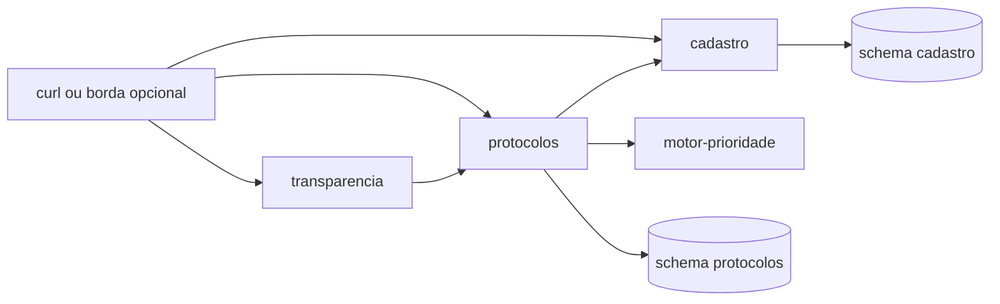

# 3SI | Global Solution 2026.2

**Disciplina:** Microservice and Web Engineering & IT Services  
**Professor:** José Romualdo  
**Turma:** 3SI, 1º semestre letivo (calendário acadêmico 2026.2)  
**Documento:** demanda específica da disciplina (80% da nota de GS desta disciplina)

> Rascunho para revisão do professor e para envio a agesandro@fiap.com.br.  
> Não linkar no portal, não citar em slide e não mergear em `main` antes da aprovação e do evento de abertura. O workflow de GitHub Pages publica o repositório inteiro a cada push em `main`.

---

## Como esta prova se encaixa na GS

A Global Solution 2026.2 tem o tema oficial **CitizenTech**: tecnologia criada a partir da necessidade de quem vive o problema, na cidade, no campo ou na comunidade, com benefício concreto para o cidadão. Pode nascer como startup, plataforma, serviço ou iniciativa de impacto, em parceria ou não com o poder público.

Há duas entregas, com pesos oficiais:

| Entrega | Peso na nota de GS da disciplina | Onde entra | O que este arquivo cobra |
|---|---|---|---|
| Demanda específica da disciplina | 80% | Área de trabalhos desta disciplina, um ZIP por grupo | O serviço abaixo, rodando |
| Pitch (slides + vídeo público no YouTube, até 5 minutos) | 20% | Área da disciplina Software Projects Quality Assurance | Nada. Slides dentro deste ZIP não somam ponto |

A nota de GS da disciplina é `0,8 × (nota desta demanda) + 0,2 × (nota do Pitch)`, cada uma de 0 a 10. Exemplo oficial: 10 e 10 viram 8 + 2 = 10.

O Pitch observa, no critério oficial de 0 a 10: slides completos (2), vídeo completo (2), criatividade (2), tecnologias do semestre (2), qualidade audiovisual (1) e participação de todos os integrantes (1). Pelo menos metade do vídeo mostra software e infraestrutura. O prazo do Pitch é 19/11/2026, 23h55. O quadro-resumo das instruções fala em 23h; o texto da seção de datas fixa 23h55.

Nesta disciplina o problema, os contratos e os números são fixos. A narrativa de oportunidade, o benchmarking, os ODS e a história de impacto ficam no Pitch. O código pedido aqui é o mesmo para toda a turma, para a correção medir a mesma arquitetura.

Fontes do recorte cívico: briefing oficial da GS 2026.2 (a zeladoria colaborativa está na lista de inspirações: identificar, priorizar e acompanhar problemas do espaço público); ONU, ODS 11, meta 11.7 (acesso universal a espaços públicos seguros, inclusivos e acessíveis); UN-Habitat, diretrizes de cidades inteligentes centradas nas pessoas, indicadas no próprio briefing.

---

## 1. Situação-problema

Um morador atravessa a mesma esquina alagada, a calçada sem rampa e o poste apagado. Registra o pedido no balcão, no telefone ou pelo aplicativo, e o pedido some. Quem atende no dia seguinte não vê o que o outro canal já abriu. A prioridade vira a opinião de quem pegou o chamado. O nome da pessoa, o texto livre e o ponto exato da ocorrência viajam juntos com o número que a comunidade precisaria acompanhar: quantos casos daquele tipo seguem abertos no bairro.

Serviços no desenho do Portal 156, da Prefeitura de São Paulo, já separam o ato de abrir um protocolo do ato de acompanhar o serviço urbano. O caso desta prova não integra o 156 e não copia a base da prefeitura. O caso pede um recorte mínimo, com a mesma natureza cívica, construído como **quatro serviços** que só se falam por HTTP.

O cidadão beneficiado é o morador que abre o protocolo por qualquer um dos três canais (aplicativo, balcão, telefone) e a vizinhança, que consulta só o agregado do bairro, sem dado pessoal. O benefício concreto é objetivo: o protocolo recebe prioridade e prazo calculados por regra pública, a transição de estado inválida é recusada, e o resumo do bairro não carrega nome, descrição nem coordenada.

---

## 2. Atividade

Você foi contratado como engenheiro de software da iniciativa **Protocolo Aberto**, uma CitizenTech de zeladoria colaborativa. Sua entrega é a malha de serviços abaixo, no ar, com contratos HTTP, persistência separada por contexto e testes de unidade com dublê.

O recorte técnico é o da espiral da disciplina até a Aula 10: API HTTP, bounded context, Docker e Compose, PostgreSQL com um schema por serviço, Strategy na regra de prioridade, e testes de unidade com Stub, Mock e Spy. O domínio deixa de ser a LogiTech. O desenho (vários processos, contrato entre eles, compose) é o mesmo tipo de problema.

Quatro processos, além do banco:

| Serviço | Porta no host | Persistência | Fala com |
|---|---|---|---|
| `cadastro` | 8081 | schema `cadastro` | ninguém |
| `motor-prioridade` | 8000 | nenhuma | ninguém |
| `protocolos` | 8080 | schema `protocolos` | `cadastro` e `motor-prioridade`, por HTTP |
| `transparencia` | 8082 | nenhuma | `protocolos`, por HTTP |



Um único processo que expõe os quatro recursos, ainda que dividido em pacotes, não atende o item de Compose. Quatro containers, quatro Dockerfiles, uma rede do Compose, chamadas pelo nome DNS do serviço (`http://cadastro:8081`, nunca `localhost` entre containers).

Pelo menos dois serviços usam linguagens diferentes, entre as já praticadas: Java (Spring Boot), C# (.NET), Python (FastAPI) ou Node (TypeScript). A distribuição é livre. Um arranjo que cabe no que a turma já fez: `cadastro` em Node, `protocolos` em Java, `motor-prioridade` em Python, `transparencia` em Python.

### Fora da nota

Ficam de fora da nota, mesmo para quem já viu o assunto depois da Aula 10: Angular, RxJS, `pgvector`, RAG, MCP, OAuth, Keycloak, JWT obrigatório, OWASP LLM, Trivy e AI Gateway. Se aparecerem, não substituem serviço, teste nem contrato.

A borda em React (TypeScript), no nível da Aula 10 (`useState`, `useEffect`, consumo da API), é opcional e não soma ponto. Serve só para mostrar, ao vivo, o consumo de `transparencia` ou de `protocolos`. A demonstração oficial é o `curl` e o `scripts/roteiro.sh`. Uma tela em Angular não ocupa esse lugar.

---

## 3. Escopo funcional

### 3.1 Entidades

**Cidadão**, dono: `cadastro`. `protocolos` guarda apenas o `cidadaoId`.

| Campo | Regra |
|---|---|
| id | UUID gerado pelo `cadastro` |
| nome | 2 a 80 caracteres |
| bairro | obrigatório |
| canal | `APP`, `BALCAO` ou `TELEFONE` |

**Protocolo**, dono: `protocolos`.

| Campo | Regra |
|---|---|
| id | UUID gerado por `protocolos` |
| cidadaoId | existe em `cadastro`; o GET do protocolo não devolve o nome |
| tipo | `ALAGAMENTO`, `ACESSIBILIDADE`, `ILUMINACAO`, `CALCADA`, `LIXO` |
| descricao | 15 a 400 caracteres |
| bairro | o lugar do problema, que pode diferir do bairro do cidadão |
| latitude, longitude | as duas juntas, ou nenhuma. Latitude de -90 a 90, longitude de -180 a 180 |
| status | nasce `ABERTO` |
| pontos, prioridade, prazoHoras, reincidente | copiados da resposta do motor no momento da criação |
| criadoEm | ISO-8601, em UTC |

**Resumo público**, calculado por `transparencia`, sem tabela própria.

| Campo | Regra |
|---|---|
| bairro | o consultado |
| porStatus | as cinco chaves, com zero quando não houver caso |
| porPrioridade | `BAIXA`, `MEDIA`, `ALTA`, `URGENTE`, com zero quando não houver caso |

Chaves proibidas no JSON do resumo: `nome`, `descricao`, `cidadaoId`, `latitude`, `longitude`, `id` de protocolo.

### 3.2 Regra de prioridade (vive no motor)

A tabela de pontos é um objeto injetável (`TabelaDePesos`), fora do handler HTTP. O teste troca ou espiona essa tabela sem editar a rota.

| Tipo | Pontos-base |
|---|---|
| ALAGAMENTO | 3 |
| ACESSIBILIDADE | 3 |
| ILUMINACAO | 2 |
| CALCADA | 2 |
| LIXO | 1 |

`ILUMINACAO` e `CALCADA` valem o mesmo de propósito. O valor devolvido não revela qual chave foi consultada. O Spy revela.

Bairros de risco, lista fixa em arquivo versionado `risco.json` no motor: `Vila Funda` e `Beira Rio`. A comparação ignora maiúsculas e espaços nas pontas e no meio (`"vila   funda"` equivale a `"Vila Funda"`). Risco soma 2.

Reincidência soma 1. Quem decide se é reincidente é `protocolos`, olhando só o próprio banco: existe protocolo do mesmo tipo e do mesmo bairro, com status `ABERTO`, `TRIADO` ou `EM_EXECUCAO`, criado há menos de 48 horas em relação ao instante `agora`. `RESOLVIDO` e `CANCELADO` não contam. O protocolo que ainda vai nascer não conta. A fronteira é estrita: 47h59 conta, 48h00 não conta. O relógio é injetável. Em produção, `agora` é o relógio do servidor.

O motor recebe o booleano pronto. Não consulta banco e não chama outro serviço.

| Pontuação | Prioridade | Prazo |
|---|---|---|
| 5 ou mais | URGENTE | 8 horas |
| 4 | ALTA | 24 horas |
| 2 ou 3 | MEDIA | 72 horas |
| 0 ou 1 | BAIXA | 168 horas |

Casos de referência, cobrados no HTTP do motor e na cadeia completa:

| tipo | bairro | reincidente | pontos | prioridade | prazo |
|---|---|---|---|---|---|
| LIXO | Centro | não | 1 | BAIXA | 168 |
| ALAGAMENTO | Vila Funda | não | 5 | URGENTE | 8 |
| CALCADA | Beira Rio | sim | 5 | URGENTE | 8 |
| ILUMINACAO | Centro | sim | 3 | MEDIA | 72 |
| ILUMINACAO | Vila Funda | não | 4 | ALTA | 24 |

### 3.3 Ciclo de vida (vive em `protocolos`)

Função pura `transicionar(atual, destino)`, fora do controller. Destino igual ao atual também é recusa.

| De | Destinos aceitos |
|---|---|
| ABERTO | TRIADO, CANCELADO |
| TRIADO | EM_EXECUCAO, CANCELADO |
| EM_EXECUCAO | RESOLVIDO, CANCELADO |
| RESOLVIDO | nenhum |
| CANCELADO | nenhum |

Transição recusada: HTTP 409 e nenhuma escrita. `ABERTO` direto para `RESOLVIDO` é o caso do roteiro.

### 3.4 Contratos HTTP

Prefixo `/api/v1` em todos. `GET /health` na raiz devolve `200` e `{"status":"ok"}`. Corpo de erro é JSON. O código HTTP abaixo é o que a rubrica lê.

**cadastro**

`POST /api/v1/cidadaos` → 201

```json
{ "nome": "Ana Lima", "bairro": "Vila Funda", "canal": "BALCAO" }
```

`GET /api/v1/cidadaos/{id}` → 200 ou 404.

**motor-prioridade**

`POST /api/v1/prioridade` → 200, ou 400 se o tipo for desconhecido.

```json
{ "tipo": "ALAGAMENTO", "bairro": "Vila Funda", "reincidente": false }
```

```json
{ "pontos": 5, "prioridade": "URGENTE", "prazoHoras": 8 }
```

**protocolos**

`POST /api/v1/protocolos` → 201. A descrição de exemplo abaixo tem mais de 15 caracteres.

```json
{
  "cidadaoId": "uuid-do-cadastro",
  "tipo": "ALAGAMENTO",
  "descricao": "Esgoto a céu aberto na esquina da praça, impedindo a passagem.",
  "bairro": "Vila Funda",
  "latitude": -23.55,
  "longitude": -46.63
}
```

Ordem obrigatória na criação:

1. `GET` em `cadastro`. 404 do cadastro vira 404 de `protocolos`, sem chamada ao motor e sem insert.
2. Cálculo de reincidência no banco de `protocolos`.
3. `POST` no motor. Motor inacessível ou resposta 5xx: `protocolos` devolve 503 e não grava.
4. Insert com os números devolvidos pelo motor e status `ABERTO`.

Tipo ausente da enumeração, descrição fora do tamanho ou coordenada incompleta: 400, sem chamada ao motor e sem insert.

`GET /api/v1/protocolos?bairro=&status=` → 200 e uma lista. Lista vazia é 200 com `[]`, não 404.

`GET /api/v1/protocolos/{id}` → 200 ou 404. O JSON não traz `nome`.

`PATCH /api/v1/protocolos/{id}/status` com `{"status":"RESOLVIDO"}` → 200 quando a transição é válida, 409 quando não é, 404 quando o id não existe.

**transparencia**

`GET /api/v1/resumo?bairro=Vila%20Funda` → 200 no formato da seção 3.1. Lê a lista de `protocolos` por HTTP e agrega. Não chama `cadastro`. Não abre conexão com o banco.

### 3.5 Fronteira de dados

Um PostgreSQL 16 no Compose. Dois schemas, dois usuários, sem grant cruzado. O arquivo `db/init.sql` cria isso na subida do banco. As tabelas podem nascer do ORM já usado na disciplina (o caminho das Aulas 05 e 07) ou do próprio SQL. Não se pede `JOIN` de aula posterior, `EXPLAIN`, `pgvector` nem SQL escrito à mão como objeto de nota.

| Variável | Onde pode existir |
|---|---|
| URL e senha do schema `cadastro` | somente no serviço `cadastro` |
| URL e senha do schema `protocolos` | somente no serviço `protocolos` |
| `CADASTRO_URL` | somente em `protocolos` |
| `MOTOR_URL` | somente em `protocolos` |
| `PROTOCOLOS_URL` | somente em `transparencia` |

`motor-prioridade` e `transparencia` sobem sem variável de banco. `transparencia` sobe sem URL de `cadastro`.

O grupo versiona `.env.exemplo` e ignora `.env`. Senha local de laboratório, no exemplo: usuário e senha `cadastro` / `cadastro` e `protocolos` / `protocolos`.

---

## 4. Fio condutor e entregáveis

O artefato é um repositório que sobe a malha do zero e um ZIP com esse repositório, incluindo a pasta `.git`. Repositório público não substitui o ZIP. A instrução oficial da GS trata solução compartilhada em Git público, WhatsApp ou Discord como quebra de sigilo; entregas iguais são zeradas para os envolvidos.

Conteúdo do ZIP, sem `node_modules`, `.venv`, `target`, `bin`, `obj` nem volume de banco:

| Caminho | O que prova |
|---|---|
| `docker-compose.yml` | os cinco serviços (`postgres`, `cadastro`, `motor-prioridade`, `protocolos`, `transparencia`), build local, healthcheck, rede interna |
| `cadastro/Dockerfile`, `motor-prioridade/Dockerfile`, `protocolos/Dockerfile`, `transparencia/Dockerfile` | um processo por imagem |
| `db/init.sql` | schemas e usuários separados |
| `risco.json` | a lista de risco versionada |
| `contratos.md` | um exemplo de request e de response de cada chamada da seção 3.4, igual ao que o roteiro envia |
| `scripts/roteiro.sh` | o roteiro da seção 4.1, saindo com código 0 |
| `README.md` | só comandos: copiar `.env`, subir o compose, rodar o teste de unidade com o compose derrubado, rodar o roteiro. Até 80 linhas |
| `docs/EVIDENCIAS.md` | os marcadores da seção 4.2, medidos neste commit |
| `.git` | 8 commits ou mais na branch entregue, mensagens que nomeiam a fatia (`cadastro`, `motor`, `protocolos`, `transparencia`, `compose`, `testes`, `roteiro`) |

### 4.1 Roteiro que o script executa

Com o compose no ar, a partir de volume vazio (`docker compose down -v` antes da medida oficial):

1. `GET /health` dos quatro serviços devolve `{"status":"ok"}`.
2. Cria a cidadã Ana Lima, canal `BALCAO`, bairro `Vila Funda`.
3. Cria protocolo `LIXO` no `Centro` para esse `cidadaoId`. A resposta traz pontos 1, `BAIXA`, prazo 168, `reincidente` false, e não traz `nome`.
4. Cria protocolo `ALAGAMENTO` na `Vila Funda`. A resposta traz pontos 5, `URGENTE`, prazo 8.
5. Cria dois protocolos `CALCADA` na `Beira Rio`, em sequência. O segundo traz pontos 5, `URGENTE`, prazo 8, `reincidente` true.
6. `PATCH` do primeiro protocolo (`LIXO`, ainda `ABERTO`) direto para `RESOLVIDO` devolve 409, e um GET seguinte ainda mostra `ABERTO`.
7. `POST` de protocolo com UUID inexistente devolve 404.
8. `GET /api/v1/resumo?bairro=Beira%20Rio` traz `CALCADA` agregada em `URGENTE` com contagem 2, e o corpo não contém `nome`, `descricao`, `cidadaoId`, `latitude` nem `longitude`.
9. `docker compose restart protocolos` e um GET do protocolo de alagamento devolvem o mesmo id e os mesmos pontos.

### 4.2 Marcadores de evidência

`docs/EVIDENCIAS.md` repete estes marcadores, com o valor medido e, abaixo de cada um, a saída do comando. Número que divergir da reexecução do professor, no mesmo commit, zera o item de rastro.

```
HEALTH_CADASTRO: {"status":"ok"}
HEALTH_MOTOR: {"status":"ok"}
HEALTH_PROTOCOLOS: {"status":"ok"}
HEALTH_TRANSPARENCIA: {"status":"ok"}
CASO_LIXO_CENTRO: 1 BAIXA 168 false
CASO_ALAGAMENTO_VILA_FUNDA: 5 URGENTE 8 false
CASO_CALCADA_BEIRA_RIO_2: 5 URGENTE 8 true
TRANSICAO_ILEGAL: 409
CIDADAO_INEXISTENTE: 404
RESUMO_BEIRA_RIO_URGENTE: 2
RESUMO_SEM_DADO_PESSOAL: sim
RESTART_MESMO_ID: sim
TESTES_UNIDADE_PASSARAM:
ROTEIRO_EXIT_CODE: 0
COMMIT_COUNT:
LINGUAGENS: 
```

`LINGUAGENS` lista o runtime de cada serviço, por exemplo `cadastro=node, motor-prioridade=python, protocolos=java, transparencia=python`.

### 4.3 Testes de unidade

A suíte roda com o compose derrubado (`docker compose down` e, em seguida, o comando de teste documentado no README) e termina verde sem PostgreSQL, sem a rede dos containers e sem `localhost` nas portas 8080, 8081, 8000 e 8082.

O nome de cada teste começa com o dublê principal, para a correção não depender de interpretação:

| Teste | O que o dublê segura |
|---|---|
| `stub_cadastro_inexistente_nao_chama_motor` | cadastro responde ausente; o cliente do motor registra zero chamadas; o repositório não recebe insert |
| `stub_motor_indisponivel_nao_persiste` | o cliente do motor falha; o repositório não recebe insert |
| `mock_motor_recebe_reincidente_true` | o repositório devolve um protocolo aberto do mesmo tipo e bairro, criado há 1 hora; o mock do motor exige um único POST com `reincidente: true` |
| `mock_tipo_invalido_nao_chama_motor` | tipo fora da enumeração; zero chamadas ao motor e zero inserts |
| `spy_iluminacao_consulta_a_propria_chave` | Spy sobre a `TabelaDePesos` real; a chave consultada é `ILUMINACAO`; o resultado base, sem risco e sem reincidência, é 2 |
| `spy_calcada_consulta_a_propria_chave` | a chave consultada é `CALCADA`; o resultado base também é 2 |
| `resumo_publico_nao_expoe_dado_pessoal` | Stub da lista de protocolos traz `nome`, `descricao`, `cidadaoId` e coordenadas; o JSON do resumo não tem essas chaves e as contagens batem com a lista |

Há ainda um teste da janela de 48 horas, com relógio injetado: um protocolo às 47h59 conta como reincidência; outro às 48h00 não conta. Esse teste pode ser puro, sobre a função de reincidência, com uma lista em memória no papel de Stub.

Biblioteca livre, dentro do que a turma usou: JUnit e Mockito, xUnit e Moq, pytest e `unittest.mock`, ou Vitest. O critério é o comportamento do dublê (resposta combinada, asserção da chamada, ou embrulho do objeto real), não o nome do framework.

Teste que só passa com o banco no ar não entra na contagem. Testcontainers, se existirem, são extra e não substituem os sete testes nomeados.

---

## 5. Método de avaliação

Equipe de 1 a 3 alunos da mesma turma. Trabalho individual é aceito e desaconselhado, na regra oficial da GS. Uma nota para o ZIP do grupo. A chamada dos dois encontros é individual: falta é registrada como falta e, por decisão desta disciplina, não altera sozinha a nota de 0 a 10 do artefato.

Somente um integrante faz o upload do ZIP na área que o professor abrir no portal. Os demais baixam o arquivo enviado e conferem se é o commit combinado. Entrega fora do formato (ZIP ausente, sem `.git`, sem compose) perde os itens correspondentes da rubrica, que é o desconto previsto na regra oficial quando o formato não é respeitado.

A nota sai do ZIP e da reexecução dele pelo professor (`docker compose down -v`, subir, testes com o compose derrubado, `scripts/roteiro.sh`). Demonstração em sala não substitui o arquivo. Arquivo que o professor não consegue subir pelo README fica sem os pontos do que não rodou.

Dúvida só nos dois encontros desta disciplina, no horário regular. Fora da aula não há atendimento, pela regra oficial.

Janela oficial da GS: 04/11/2026 a 19/11/2026. Em 04/11/2026 não há aula desta disciplina; as aulas ficam suspensas para o evento de abertura, no horário divulgado pela coordenação. Esta demanda é apresentada no primeiro encontro da disciplina dentro da janela e entregue até o fim do dia do segundo encontro.

Leitura do calendário publicado da disciplina (terças, 19h20 às 22h50), decisão de aplicação se a coordenação não mover a aula:

| Encontro | Data | O que acontece com esta demanda |
|---|---|---|
| 1º | 10/11/2026 | Enunciado apresentado. Dúvidas e construção em sala |
| 2º | 17/11/2026 | Fechamento da integração. Entrega até 23h55 deste dia |

Se a coordenação mudar o dia da aula, o primeiro e o segundo encontros reais, dentro de 04/11 a 19/11, ocupam essas duas linhas. O Pitch continua com o prazo institucional de 19/11/2026, 23h55, em outra área.

Entrega de arquivo errado, ou portal fechado, segue a regra oficial: cada aluno faz a prova substitutiva individual no calendário acadêmico. O enunciado da substitutiva não faz parte deste documento.

---

## 6. Rubrica

Nota desta demanda, de 0 a 10. É o componente de 80%. O Pitch não entra nesta tabela.

| # | Item | Pontos | Medida | Corte |
|---|---|---|---|---|
| 1 | Compose da malha | 2,0 | `docker compose down -v && docker compose up -d --build` deixa `postgres` e os quatro serviços saudáveis | 0,5 a menos se faltar healthcheck ou se a chamada entre containers usar `localhost`. 0,5 a menos se os quatro serviços estiverem na mesma linguagem. 0,5 a menos por serviço ausente, com piso 0. Um processo só: 0 neste item |
| 2 | Fronteiras e contratos | 2,0 | `db/init.sql`, variáveis da seção 3.5, GET de protocolo sem `nome`, 404 sem chamada ao motor, resumo sem dado pessoal | 1,0 pelas fronteiras de schema e de ambiente. 0,5 pelo comportamento HTTP do roteiro. 0,5 pelo teste `resumo_publico_nao_expoe_dado_pessoal` verde. URL de banco alheio dentro de um serviço zera a fronteira (1,0) |
| 3 | Regra e ciclo de vida | 2,0 | casos LIXO/Centro, ALAGAMENTO/Vila Funda e segunda CALCADA/Beira Rio com os números da seção 3.2; 409 sem gravar a transição ilegal | 1,0 pelos três casos na cadeia HTTP. 0,5 pelo 409. 0,5 pela tabela de pesos fora do handler e substituível no teste. Caso de referência errado zera os 1,0 dos casos |
| 4 | Stub, Mock e Spy | 2,0 | os sete testes nomeados verdes com o compose derrubado, mais o teste da janela de 48 horas | Falta de um dos três dublês (nenhum Stub, ou nenhum Mock, ou nenhum Spy): teto 1,0. Suíte que só passa com Postgres: teto 1,0 |
| 5 | Rastro reproduzível | 2,0 | `.git` com 8 commits ou mais, marcadores coerentes com a reexecução, `scripts/roteiro.sh` com saída 0 | 0,5 o histórico (0 sem `.git`; 0,5 com 4 a 7 commits; 0,5 com 8 ou mais). 0,5 as evidências, zeradas se um marcador divergir. 1,0 o roteiro |
| | **Total** | **10,0** | | |

Bônus não existe. React, segundo front, function calling ou um quinto serviço não elevam a nota acima de 10 e não compensam item zerado.

---

## 7. Dinâmica em sala

Presença nos dois encontros, chamada no início. A sala é o lugar de construir a malha e de destravar erro concreto de contrato, de compose e de teste. Não é horário livre para o Pitch.

### Encontro 1, 10/11/2026, 19h20 às 22h50

| Horário | O que a sala produz |
|---|---|
| 19h20 | Chamada |
| 19h30 às 20h00 | Enunciado, separação entre esta demanda e o Pitch, grupos de até 3, registro dos RMs |
| 20h00 às 20h50 | `contratos.md` fechado antes do código da integração. Postgres no ar com `db/init.sql`. `cadastro` grava e devolve um cidadão |
| 20h50 às 21h20 | Intervalo |
| 21h20 às 22h20 | `motor-prioridade` responde os casos LIXO/Centro e ALAGAMENTO/Vila Funda. Os dois testes de Spy verdes |
| 22h20 às 22h50 | Cada grupo mostra os dois `/health` e os dois Spy. Quem não mostrar leva esta meta para casa |

Para casa, até o encontro 2: Dockerfiles, `protocolos` persistindo e chamando os dois vizinhos com os testes de Stub e de Mock verdes, `transparencia` agregando uma lista fixa no teste de dado pessoal.

### Encontro 2, 17/11/2026, 19h20 às 22h50

| Horário | O que a sala produz |
|---|---|
| 19h20 | Chamada |
| 19h30 às 20h50 | Compose único a partir de volume vazio. Ajuste de URL interna, de schema e de código HTTP. O professor olha falha de contrato com o grupo |
| 20h50 às 21h20 | Intervalo |
| 21h20 às 22h20 | `scripts/roteiro.sh` verde. `docs/EVIDENCIAS.md` preenchido com a saída real. Amostra: um ou mais grupos rodam o roteiro na máquina da sala, do `down -v` até o exit code 0 |
| 22h20 às 22h50 | Empacotar o ZIP sem dependências baixadas. Última dúvida. Upload até 23h55 deste dia |

O que pode ir para casa: implementação entre os dois encontros e o fechamento depois da aula, até 23h55 de 17/11/2026. O que fica na sala: a apresentação do enunciado, a correção de contrato que o grupo não consegue ver sozinho, e a amostra do roteiro.

---

## 8. Checklist para o e-mail ao Agesandro

Seção interna. Não entra no texto publicado para a turma. Destinatário: agesandro@fiap.com.br.

Assunto sugerido: `Demanda específica da GS 2026.2 | Microservice and Web Engineering & IT Services | 3SI | CitizenTech`

- [ ] Anexar este arquivo, ou o PDF exportado dele se a coordenação pedir PDF. Não anexar link do GitHub Pages nem de branch pública.
- [ ] No corpo, uma frase: a demanda é a prova da disciplina (peso 80), no tema CitizenTech, e o Pitch (peso 20) segue na área de Software Projects Quality Assurance.
- [ ] Informar as datas propostas: apresentação em 10/11/2026, entrega em 17/11/2026 até 23h55, dentro da janela oficial de 04/11/2026 a 19/11/2026.
- [ ] Informar o recorte técnico: quatro serviços em Compose, contratos HTTP, PostgreSQL com schema por contexto, testes com Stub, Mock e Spy. React apenas como borda opcional, sem ponto. Sem Angular, RAG ou Keycloak como requisito.
- [ ] Pedir aprovação explícita antes de abrir a área de entrega no portal e antes de divulgar o enunciado à turma.
- [ ] Confirmar o horário do evento de abertura de 04/11/2026. O PDF oficial remete ao horário divulgado pela coordenação.
- [ ] Combinar que o merge deste arquivo em `main` espera essa aprovação, porque o Pages publica o repositório inteiro.
- [ ] Não anexar gabarito executável nem solução de aluno.
- [ ] Depois do ok: abrir a área da disciplina pedindo um único ZIP por grupo, com `.git`, e manter o Pitch na área já definida pela coordenação.
